# Arquitetura

Como o código do projeto se encaixa. O que é decidido (definições, limiares, análise) está no [protocolo](protocolo.md); aqui só ficam os componentes, os esquemas de dados e como rodar.

## Visão geral

```mermaid
flowchart LR
  A[(Coleção do Anki)] -->|AnkiConnect ou JSONL do add-on| B[export]
  B --> C[cards.jsonl: elegibilidade estrutural]
  C --> D[generate: LLM fixo gera 4 variantes por cartão]
  D --> E[validate: checagens lexicais + juiz]
  E --> F[audit-sheet / audit-score: auditoria humana, H1]
  F --> G[pack: variant_bank.json]
  G --> H[Add-on v1: sorteia, exibe e registra]
  A --> H
  H --> I[(SQLite de eventos)]
  I --> J[CSV] --> K[Análise em Python: DiD, IC 95%]
```



O add-on v0 (esta versão) cobre só `A -> I -> J`: registra as revisões e o tempo até revelar, sem alterar cartões. O ramo `G -> H` (sorteio e exibição) é o marco M3.

## Componentes

| Pasta | O que é | Estado (20/10) |
|---|---|---|
| `addon/dfc_probe/` | Add-on do Anki (Python, só desktop) | v0 (só registro): testado com Anki simulado; falta rodar no Anki real |
| `pipeline/dfc_pipeline/` | Exportar, gerar, validar, auditar e empacotar variantes | Testado com LLM falso e servidor HTTP local; falta chave e modelo reais |
| `tests/` | 29 testes (`scripts/run_tests.ps1`) | Passando |
| `scripts/` | Instalar e empacotar o add-on, rodar os testes | |
| `data/` (ignorado pelo Git) | `cards.jsonl`, `generation.jsonl`, `validation.jsonl`, auditoria e banco | Contém texto de cartões: não versionar |

## Add-on (v0)

- **Ganchos do Anki** ([`genhooks_gui.py`](https://github.com/ankitects/anki/blob/main/qt/tools/genhooks_gui.py)): `reviewer_did_show_question` (guarda o estado do cartão antes da resposta), `reviewer_did_show_answer` (tempo até revelar) e `reviewer_did_answer_card` (grava o evento). No v1: `card_will_show` para trocar o texto, nos dois lados do cartão.
- **Só desktop:** add-ons não rodam no AnkiDroid nem no iOS; revisões no celular não geram eventos.
- **Estado antes da resposta:** `reps`, `lapses`, intervalo, dias de atraso, dias desde a última revisão (consulta ao `revlog`), últimas três respostas, modo (regular, filtrado, filtrado sem reagendar) e, se existirem, estabilidade e dificuldade do FSRS.
- **Privacidade:** o banco não guarda texto de cartão. Na exportação de CSV, `anonymize_export` troca os IDs e o nome do baralho por hash com sal da instalação.
- **Falhas:** todo gancho é protegido; um erro vai para `user_files/dfc_errors.log` e nunca interrompe a revisão.
- **Menu** (Ferramentas > DFC Probe): Registro ativo, Status, Exportar eventos (CSV) e Exportar notas para variantes (JSONL).

Instalar: feche o Anki, rode `.\scripts\install_addon.ps1` e abra o Anki. Para outra pessoa: `.\scripts\package_addon.ps1` gera `dist\dfc_probe.ankiaddon`.

## Pipeline

Rodar na raiz do repositório com `$env:PYTHONPATH = "pipeline"`; variáveis em `.env` (modelo em `.env.example`).

| Comando | O que faz |
|---|---|
| `python -m dfc_pipeline export --query "deck:HTTPS"` | Lê notas via AnkiConnect (ou `--source file --in-file notas.jsonl`, do add-on) e marca a elegibilidade estrutural; imprime elegíveis e elegíveis suspeitos por baralho |
| `generate [--limit N] [--dry-run]` | Uma chamada ao LLM por cartão elegível: 4 variantes (`paraphrase`, `reorder`, `reformat`, `cue_swap`) e o sinal `conceptual`. Retomável |
| `validate` | Distância lexical, vazamento e juiz por LLM (modelo diferente do gerador). Retomável |
| `audit-sheet --n 100` / `audit-score` | Planilha estratificada por tipo para o autor marcar `s`/`n`; calcula a taxa de válidas (H1) com IC de Wilson e os tipos abaixo de 70% |
| `pack` | Banco `variant_bank.json` só com variantes aprovadas e cujo cartão não foi editado depois da geração |
| `stats` | Resumo, incluindo tokens usados |

`--dry-run` usa um LLM falso para testar o fluxo; o `pack` recusa saídas do modelo `fake` sem `--allow-fake`. Cada registro de geração e de validação traz modelo, versão do prompt (`gen-v1`, `judge-v1`), temperatura e data.

## Esquemas

**Evento** (tabela `events` do SQLite, uma linha por revisão; colunas em `addon/dfc_probe/core.py`): identificação (`event_id`, `session_id`, `seq`, versões), horários (`q_shown_at`, `a_shown_at`, `answered_at`), cartão (`note_id`, `card_id`, `card_ord`, `deck_id`, `model_name`), estado antes da resposta, desfecho (`ease`, `t_reveal_ms`, `t_total_ms`) e experimento (`arm`, `variant_id`, `variant_type`, `flag_bad`; vazios até o v1).

**Banco de variantes** (`variant_bank.json`):

```json
{
  "schema": 1,
  "generated_at": "...",
  "generator_models": ["..."],
  "judge_models": ["..."],
  "notes": {
    "1746197886984": {
      "kind": "basic",
      "ords": [0],
      "fields_hash": "a1b2c3d4e5f6",
      "variants": [{"id": "1746197886984-paraphrase-1f2e3d", "type": "paraphrase", "text": "..."}]
    }
  }
}
```

`fields_hash` (SHA-1 dos campos brutos) permite ao add-on ignorar variantes de uma nota editada depois da geração. Em notas Cloze, `ords` é o número da lacuna menos 1 e há `answer_html` para preencher o lado da resposta.

## Limites conhecidos

- O add-on não foi executado no Anki real; o teste de fumaça usa um `aqt` simulado e só cobre ligação e lógica, não mudanças de API.
- Elegibilidade estrutural não decide "conceitual": isso é o sinal `conceptual` do LLM, conferido na auditoria.
- Notas Cloze com mais de uma lacuna ficam fora (seção 4.2 do protocolo).
- O código do Anki é AGPL-3; o add-on usa a API dele, e as implicações de licença † precisam ser conferidas antes de publicar o código.
