# Arquitetura

Como o código do projeto se encaixa. O que é decidido (definições, limiares, análise) está no [protocolo](protocolo.md); aqui só ficam os componentes, os esquemas de dados e como rodar.

## Visão geral

```mermaid
flowchart LR
  A[(Coleção do Anki)] -->|AnkiConnect ou JSONL do add-on| B[export]
  B --> C[cards.jsonl: elegibilidade estrutural]
  C --> D[generate: LLM fixo gera 4 variantes por cartão]
  D --> E[validate: checagens lexicais + juiz]
  E --> F[audit-sheet / audit-score: auditoria humana, H1]
  F --> G[pack: variant_bank.json]
  G --> H[Add-on v1: sorteia, exibe e registra]
  A --> H
  H --> I[(SQLite de eventos)]
  I --> J[CSV] --> K[Análise em Python: DiD, IC 95%]
```



O add-on cobre `A -> H -> I -> J`: registra as revisões e, na janela do estudo, sorteia e exibe a variante. O banco de variantes (`G`) é importado pelo menu; as variantes só existem na tela, nada é gravado nas notas.

## Componentes

| Pasta | O que é | Estado (20/10) |
|---|---|---|
| `addon/dfc_probe/` | Add-on do Anki (Python, só desktop) | v0.2.0 (registro, sorteio e exibição). Registro conferido no Anki 26.05 real contra o revlog (12 revisões, 0 divergências); sorteio e exibição testados com o motor real do Anki 26.5 (pacote `anki`, sem interface); falta o teste de fumaça na interface |
| `pipeline/dfc_pipeline/` | Exportar, gerar, validar, auditar e empacotar variantes | Testado com LLM falso e servidor HTTP local; falta chave e modelo reais |
| `tests/` | 86 testes (`scripts/run_tests.ps1`; 10 deles só rodam com o pacote `anki`: `-Real`) | Passando |
| `scripts/` | Instalar e empacotar o add-on, rodar os testes | |
| `data/` (ignorado pelo Git) | `cards.jsonl`, `generation.jsonl`, `validation.jsonl`, auditoria e banco | Contém texto de cartões: não versionar |

## Add-on

- **Ganchos do Anki** ([`genhooks_gui.py`](https://github.com/ankitects/anki/blob/main/qt/tools/genhooks_gui.py)): `card_will_show` (decide o braço e troca o texto da pergunta e, depois, o da resposta), `reviewer_did_show_question` (horário da pergunta), `reviewer_did_show_answer` (tempo até revelar) e `reviewer_did_answer_card` (grava o evento), além de `state_shortcuts_will_change` e `reviewer_will_show_context_menu` (variante ruim).
- **Exposição:** a cada pergunta mostrada o add-on abre uma exposição (estado do cartão antes da resposta, `event_id`) e decide uma vez; se o Anki redesenhar o mesmo cartão (por exemplo, depois de editar a nota), a decisão é mantida.
- **Elegibilidade e sorteio** (`variants.py`, sem imports do Anki): a nota está no banco, `card.ord` está em `ords`, o hash dos campos é o do banco (nota não editada), `reps ≥ 1`, a última revisão foi em outro dia do Anki e a data está na janela. Então: 50/50 com semente por evento (HMAC do `event_id` com o sal da instalação; a semente fica em `draw_seed`). A variante é uma ainda não mostrada naquele cartão (histórico no próprio SQLite). O motivo de cada não sorteio fica em `draw_note`.
- **Troca do texto:** a variante vai para uma cópia da nota (o campo da pergunta, `q_field`; em Cloze, a lacuna volta como `{{cN::resposta}}`), que o Anki renderiza com o template real do tipo de nota; o gancho troca no texto que o Anki entrega a renderização do original pela da variante. Se o original não aparece no texto (template ou outro add-on mudou a saída), mostra o original e marca `shown_ok = 0`. `arm` é o braço sorteado; a análise usa `shown_ok = 1`.
- **Segurança:** nenhuma nota é gravada; qualquer erro devolve o texto original; banco gerado com `--dry-run` (variantes falsas) não sorteia, a menos que `allow_fake_bank` esteja ligado (`draw_note = fake_bank`).
- **Variante ruim:** tecla `b` (configurável) ou menu de contexto da revisão marcam a exposição atual; Ferramentas > DFC Probe marca a resposta anterior (`flag_bad`).
- **Só desktop:** add-ons não rodam no AnkiDroid nem no iOS; revisões no celular não geram eventos.
- **Estado antes da resposta:** `reps`, `lapses`, intervalo, dias de atraso, dias desde a última revisão (consulta ao `revlog`, ignorando entradas manuais), `same_day` (a última revisão foi no mesmo dia do Anki, pela virada de dia do próprio Anki), `n_reviews` (entradas do tipo revisão no `revlog`; o `reps` do Anki inclui passos de aprendizado), últimas três respostas, modo (regular, filtrado, filtrado sem reagendar), agendador em uso (`scheduler`: `fsrs` ou `sm2`), retenção desejada (`desired_retention`, só com FSRS) e, se existirem, estabilidade e dificuldade do FSRS.
- **Privacidade:** o banco não guarda texto de cartão. Na exportação de CSV, `anonymize_export` troca os IDs, o nome do baralho e o do perfil por hash com sal da instalação.
- **Respostas desfeitas (Ctrl+Z):** o evento continua no banco, mas a exportação o marca: `revlog_match` (o histórico de revisões do Anki tem a resposta?) e `superseded` (o mesmo cartão e o mesmo `reps` reaparecem depois, porque o Anki só avança `reps` com resposta válida). Ambas as colunas são derivadas na exportação, não ficam no banco.
- **Falhas:** todo gancho é protegido; um erro vai para `user_files/dfc_errors.log` e nunca interrompe a revisão.
- **Menu** (Ferramentas > DFC Probe): Registro ativo, Sorteio ativo, Status, Importar banco de variantes, Marcar a última resposta como variante ruim, Exportar eventos (CSV) e Exportar notas para variantes (JSONL).

Instalar: feche o Anki, rode `.\scripts\install_addon.ps1` e abra o Anki. Para outra pessoa: `.\scripts\package_addon.ps1` gera `dist\dfc_probe.ankiaddon`.

**Teste de fumaça do sorteio (Anki real).** Banco de teste (variantes falsas, fáceis de reconhecer): `data/bank/variant_bank_fake.json`, feito com `--dry-run` e `pack --allow-fake`. Em Complementos > DFC Probe > Config: `draw_start` = hoje e `allow_fake_bank` = `true`; Ferramentas > DFC Probe > Importar banco de variantes. Revisar cartões do AWS ou HTTPS: cerca de metade deve mostrar o texto falso nos dois lados; `b` marca a variante; Ctrl+Z e responder de novo; Ferramentas > DFC Probe > Status. Depois: `draw_start` = `2026-11-02`, `allow_fake_bank` = `false` e importar o banco real antes de 2/11. Eventos fora da janela não entram na análise.

## Pipeline

Rodar na raiz do repositório com `$env:PYTHONPATH = "pipeline"`; variáveis em `.env` (modelo em `.env.example`).

| Comando | O que faz |
|---|---|
| `python -m dfc_pipeline export --query "deck:HTTPS"` | Lê notas via AnkiConnect (ou `--source file --in-file notas.jsonl`, do add-on) e marca a elegibilidade estrutural; imprime elegíveis e elegíveis suspeitos por baralho |
| `generate [--limit N] [--dry-run]` | Uma chamada ao LLM por cartão elegível: 4 variantes (`paraphrase`, `reorder`, `reformat`, `cue_swap`) e o sinal `conceptual`. Retomável |
| `validate` | Distância lexical, vazamento e juiz por LLM (modelo diferente do gerador). Retomável |
| `audit-sheet --n 100` / `audit-score` | Planilha estratificada por tipo para o autor marcar `s`/`n`; calcula a taxa de válidas (H1) com IC de Wilson e os tipos abaixo de 70% |
| `pack` | Banco `variant_bank.json` só com variantes aprovadas e cujo cartão não foi editado depois da geração |
| `stats` | Resumo, incluindo tokens usados |

`--dry-run` usa um LLM falso para testar o fluxo; o `pack` recusa saídas do modelo `fake` sem `--allow-fake`. Cada registro de geração e de validação traz modelo, versão do prompt (`gen-v1`, `judge-v1`), temperatura e data.

## Esquemas

**Evento** (tabela `events` do SQLite, uma linha por revisão; colunas em `addon/dfc_probe/core.py`): identificação (`event_id`, `session_id`, `seq`, versões, `profile`), horários (`q_shown_at`, `a_shown_at`, `answered_at`), cartão (`note_id`, `card_id`, `card_ord`, `deck_id`, `model_name`), estado antes da resposta, desfecho (`ease`, `t_reveal_ms`, `t_total_ms`) e experimento (`arm`, `variant_id`, `variant_type`, `flag_bad`; vazios até o v1). O CSV exportado acrescenta `revlog_match` e `superseded`. Ainda faltam, para o v1: hash do texto exibido, versão do banco de variantes e semente do sorteio.

**Banco de variantes** (`variant_bank.json`):

```json
{
  "schema": 1,
  "generated_at": "...",
  "generator_models": ["..."],
  "judge_models": ["..."],
  "notes": {
    "1746197886984": {
      "kind": "basic",
      "ords": [0],
      "fields_hash": "a1b2c3d4e5f6",
      "variants": [{"id": "1746197886984-paraphrase-1f2e3d", "type": "paraphrase", "text": "..."}]
    }
  }
}
```

`fields_hash` (SHA-1 dos campos brutos) permite ao add-on ignorar variantes de uma nota editada depois da geração. Em notas Cloze, `ords` é o número da lacuna menos 1 e há `answer_html` para preencher o lado da resposta.

## Limites conhecidos

- **Agendador diferente entre participantes:** o autor usa FSRS e o irmão provavelmente SM-2. O sorteio é dentro de cada revisão, então o agendador não enviesa a comparação original x variante; ele muda a taxa-base de falha e os intervalos, e entra como covariável (`scheduler`, `log(intervalo)`, dias desde a última revisão). Estabilidade e dificuldade do FSRS só existem para quem usa FSRS e ficam para a análise de sensibilidade. Cada pessoa mantém o agendador como já usa; durante a janela, ninguém liga ou desliga o FSRS, muda a retenção desejada nem roda "Otimizar" (isso reescreve datas).
- O sorteio e a exibição (v0.2.0) foram testados com o motor real do Anki 26.5 (pacote `anki`, sem interface: renderização Basic e Cloze, estado real do cartão, dia do Anki, revlog) e com um `aqt` simulado; as telas (Qt), os atalhos e a exibição no Reviewer só se confirmam no teste de fumaça acima, e uma mudança de API do Anki depois da 26.05 não seria pega (por isso o Anki fica fixo na 26.05). O registro foi conferido contra o `revlog` em 20/10 (12 revisões, 0 divergências; o teste de Ctrl+Z confirmou que a resposta desfeita não tem par no `revlog`).
- Elegibilidade estrutural não decide "conceitual": isso é o sinal `conceptual` do LLM, conferido na auditoria.
- Notas Cloze com mais de uma lacuna ficam fora (seção 4.2 do protocolo).
- O código do Anki é AGPL-3; o add-on usa a API dele, e as implicações de licença † precisam ser conferidas antes de publicar o código.
