# Arquitetura

Como o código do projeto se encaixa. O que é decidido (definições, limiares, análise) está no [protocolo](protocolo.md); aqui só ficam os componentes, os esquemas de dados e como rodar.

## Visão geral

```mermaid
flowchart LR
  A[(Coleção do Anki)] -->|AnkiConnect ou JSONL do add-on| B[export]
  B --> C[cards.jsonl: elegibilidade estrutural]
  C --> D[generate: LLM fixo gera as variantes: Basico 4 tipos, Cloze 4 tipos de texto]
  D --> E[validate: checagens lexicais + juiz]
  E --> F[audit-sheet / audit-score: auditoria humana, H1]
  F --> G[pack: variant_bank.json, com sem_imagem nas fichas com imagem]
  G --> H[Add-on v1: sorteia, exibe e registra]
  A --> H
  H --> I[(SQLite de eventos)]
  I --> J[CSV] --> K[Análise em Python: DiD, IC 95%]
```



O add-on cobre `A -> H -> I -> J`: registra as revisões e, na janela do estudo, sorteia e exibe a variante. O banco de variantes (`G`) é importado pelo menu; as variantes só existem na tela, nada é gravado nas notas.

## Componentes

| Pasta | O que é | Estado (20/10) |
|---|---|---|
| `addon/dfc_probe/` | Add-on do Anki (Python, só desktop) | v0.3.0 (registro, sorteio e exibição; fichas Cloze com várias lacunas e imagens, protocolo v1.2). Registro conferido no Anki 26.05 real contra o revlog (12 revisões, 0 divergências); sorteio e exibição testados com o motor real do Anki 26.5 (pacote `anki`, sem interface) e, em 20/10, no Anki real com a 0.2.x (variante nos dois lados, nota intacta, tecla `x`, mesma variante após Ctrl+Z); o teste de fumaça achou três defeitos (tecla `b`, novo sorteio e marca de variante ruim perdida após Ctrl+Z), corrigidos nas versões 0.2.1 e 0.2.2. A 0.3.0 (`pergunta`, `sem_imagem`, imagens) foi testada com o motor real e ainda não foi vista na interface |
| `pipeline/dfc_pipeline/` | Exportar, gerar, validar, auditar e empacotar variantes | Testado com LLM falso e servidor HTTP local (Básico e Cloze: fichas com 1 a 3 lacunas e imagem); falta chave e modelo reais |
| `tests/` | 125 testes (`scripts/run_tests.ps1`; 16 deles só rodam com o pacote `anki`: `-Real`) | Passando |
| `scripts/` | Instalar e empacotar o add-on, rodar os testes, conferir a exibição de um banco numa cópia da coleção (`render_check.py`) | |
| `data/` (ignorado pelo Git) | `cards.jsonl`, `generation.jsonl`, `validation.jsonl`, auditoria e banco | Contém texto de cartões: não versionar |

## Add-on

- **Ganchos do Anki** ([`genhooks_gui.py`](https://github.com/ankitects/anki/blob/main/qt/tools/genhooks_gui.py)): `card_will_show` (decide o braço e troca o texto da pergunta e, depois, o da resposta), `reviewer_did_show_question` (horário da pergunta), `reviewer_did_show_answer` (tempo até revelar) e `reviewer_did_answer_card` (grava o evento), além de `state_shortcuts_will_change` e `reviewer_will_show_context_menu` (variante ruim).
- **Exposição:** a cada pergunta mostrada o add-on abre uma exposição (estado do cartão antes da resposta, `event_id`) e decide uma vez; se o Anki redesenhar o mesmo cartão (por exemplo, depois de editar a nota), a decisão é mantida.
- **Elegibilidade e sorteio** (`variants.py`, sem imports do Anki): a nota está no banco, `card.ord` está em `ords`, o hash dos campos é o do banco (nota não editada), `reps ≥ 1`, a última revisão foi em outro dia do Anki e a data está na janela. Então: 50/50 com semente por evento (HMAC do `event_id` com o sal da instalação; a semente fica em `draw_seed`). A variante é uma ainda não mostrada naquele cartão (histórico no próprio SQLite). O motivo de cada não sorteio fica em `draw_note`.
- **Troca do texto:** a variante vai para uma cópia da nota (o campo da pergunta, `q_field`), que o Anki renderiza com o template real do tipo de nota; o gancho troca no texto que o Anki entrega a renderização do original pela da variante. Se o original não aparece no texto (template ou outro add-on mudou a saída), mostra o original e marca `shown_ok = 0`. `arm` é o braço sorteado; a análise usa `shown_ok = 1`. Antes da troca, as quatro renderizações (pergunta e resposta, original e variante) passam pelo mesmo escape de nomes de mídia que o Reviewer aplica ao texto antes do gancho (no Anki 26.05, `encode_iri_paths`: o espaço vira `%20` e o acento fica); sem isso, uma imagem com espaço no nome faria a troca falhar (`template_mismatch`).
- **Cloze (v1.2 e v1.3):** as variantes de texto (`paraphrase`, `reorder`, `cue_swap`, `pergunta`) trocam o campo por um bloco centralizado com as imagens originais (`images_html`) e o texto da variante, em que cada marcador `[...]` (uma lacuna) ou `[...1]`, `[...2]`, `[...3]` volta a ser `{{cN::resposta}}` com a resposta original (`answers_html`); o marcador leva a sua resposta mesmo fora de ordem (no `reorder`); a `sem_imagem` não tem texto: o add-on tira as `` do campo atual da nota e o resto do HTML (a formatação) fica como está. Em toda exposição sorteada, nos dois braços, o evento traz `note_kind`, `n_blanks` e `has_image`: com a exportação anonimizada o `note_id` vira hash e não dá para juntar o evento ao banco depois.
- **Segurança:** nenhuma nota é gravada; qualquer erro devolve o texto original; banco gerado com `--dry-run` (variantes falsas) não sorteia, a menos que `allow_fake_bank` esteja ligado (`draw_note = fake_bank`).
- **Variante ruim:** tecla `x` (configurável) ou menu de contexto da revisão marcam a exposição atual; Ferramentas > DFC Probe marca a resposta anterior (`flag_bad`). A `b` não serve: no Anki ela é tecla global (abre o Navegador) e, repetida, o Qt anula as duas (`setupKeys` em `aqt/main.py`: `d`, `s`, `a`, `b`, `t`, `y`). Se a tecla configurada for uma dessas ou já estiver na lista da revisão, o add-on avisa e usa `x`. Depois de um Ctrl+Z a marca continua, porque a variante é a mesma.
- **Só desktop:** add-ons não rodam no AnkiDroid nem no iOS; revisões no celular não geram eventos.
- **Estado antes da resposta:** `reps`, `lapses`, intervalo, dias de atraso, dias desde a última revisão (consulta ao `revlog`, ignorando entradas manuais), `same_day` (a última revisão foi no mesmo dia do Anki, pela virada de dia do próprio Anki), `n_reviews` (entradas do tipo revisão no `revlog`; o `reps` do Anki inclui passos de aprendizado), últimas três respostas, modo (regular, filtrado, filtrado sem reagendar), agendador em uso (`scheduler`: `fsrs` ou `sm2`), retenção desejada (`desired_retention`, só com FSRS) e, se existirem, estabilidade e dificuldade do FSRS.
- **Privacidade:** o banco não guarda texto de cartão. Na exportação de CSV, `anonymize_export` troca os IDs, o nome do baralho e o do perfil por hash com sal da instalação. No irmão a opção fica desligada (decisão de 21/10: os dados ficam só com o autor e o irmão) e o `note_id` real liga cada evento ao texto exportado, que o E3 usa; para compartilhar com terceiros, ligar a opção e tirar o texto de cartão.
- **Respostas desfeitas (Ctrl+Z):** o evento continua no banco, mas a exportação o marca: `revlog_match` (o histórico de revisões do Anki tem a resposta?) e `superseded` (o mesmo cartão e o mesmo `reps` reaparecem depois, porque o Anki só avança `reps` com resposta válida). Ao desfazer, o cartão volta ao mesmo estado (mesmo `reps`) e o add-on trata a nova exibição como a mesma exposição: mantém braço, variante, semente e marca de variante ruim (`draw_note = undo_redo`). Sem isso, desfazer serviria para sortear de novo e escapar de uma variante difícil, e o evento válido deixaria de ser o sorteado. Só vale para o mesmo cartão logo depois da resposta desfeita, dentro da mesma sessão do Anki e fora do modo filtrado sem reagendar (lá o `reps` pode não avançar). A resposta refeita já viu a resposta certa: `after_undo = 1` marca esses eventos (sensibilidade). As três colunas são derivadas na exportação, não ficam no banco.
- **Falhas:** todo gancho é protegido; um erro vai para `user_files/dfc_errors.log` e nunca interrompe a revisão.
- **Menu** (Ferramentas > DFC Probe): Registro ativo, Sorteio ativo, Status, Importar banco de variantes, Marcar a última resposta como variante ruim, Exportar eventos (CSV) e Exportar notas para variantes (JSONL).

Instalar: feche o Anki, rode `.\scripts\install_addon.ps1` e abra o Anki. Para outra pessoa: `.\scripts\package_addon.ps1` gera `dist\dfc_probe.ankiaddon`.

**Teste de fumaça do sorteio (Anki real).** Banco de teste (variantes falsas, fáceis de reconhecer): `data/bank/variant_bank_fake.json`, feito com `--dry-run` e `pack --allow-fake`. Em Complementos > DFC Probe > Config: `draw_start` = hoje e `allow_fake_bank` = `true`; Ferramentas > DFC Probe > Importar banco de variantes. Revisar cartões do AWS ou HTTPS: cerca de metade deve mostrar o texto falso nos dois lados; `x` marca a variante (aparece "variante marcada como ruim"); Ctrl+Z e responder de novo: o mesmo texto (original ou falso) deve voltar; Ferramentas > DFC Probe > Status. Depois: `draw_start` = `2026-11-02`, `allow_fake_bank` = `false` e importar o banco real antes de 2/11. Eventos fora da janela não entram na análise.

**Conferir a exibição em todas as notas.** `python scripts/render_check.py --bank <banco>` (mesmo ambiente do `-Real`, com o pacote `anki`) copia a coleção, renderiza cada variante com o template real de cada tipo de nota e repete a troca que o gancho faz; acusa `render_failed`, `template_mismatch`, `answer_mismatch`, `swap_failed` ou `nota_editada` e sai com código 1 se houver falha. Em 20/10, com um banco falso de 709 notas e 2836 variantes sobre a coleção do autor: 2836 de 2836 corretas (Basic 1224, Einfach 160, Einfach+ 40, Omissão de Palavras 1412; as notas Cloze são 50% das elegíveis e 71% das com `reps ≥ 5` e `lapses = 0`). Repetir com o banco real antes de 2/11 e, no Anki de cada participante, ver ao menos uma `pergunta` e uma `sem_imagem` de ficha (com imagem) na interface.

## Pipeline

Rodar na raiz do repositório com `$env:PYTHONPATH = "pipeline"`; variáveis em `.env` (modelo em `.env.example`). O provedor é qualquer API compatível com a de chat da OpenAI (OpenRouter, Maritaca, Gemini etc.): muda só `DFC_LLM_BASE_URL`, a chave e os IDs dos modelos.

| Comando | O que faz |
|---|---|
| `python -m dfc_pipeline export --query "deck:HTTPS"` | Lê notas via AnkiConnect (ou `--source file --in-file notas.jsonl`, do add-on) e marca a elegibilidade estrutural; imprime elegíveis e elegíveis suspeitos por baralho |
| `generate [--limit N] [--workers N] [--dry-run]` | Uma chamada ao LLM por cartão elegível e o sinal `conceptual`. Básico: 4 variantes (`paraphrase`, `reorder`, `reformat`, `cue_swap`); Cloze: `paraphrase`, `reorder`, `cue_swap` e `pergunta`, com os marcadores das lacunas. Retomável; `--workers` faz N chamadas ao mesmo tempo (os registros são gravados sempre pela thread principal, na ordem de conclusão); `--max-failures N` (padrão 15) interrompe depois de N falhas seguidas (crédito, chave ou rede) e `--retry-errors` refaz só as notas com erro |
| `validate [--workers N]` | Distância lexical, vazamento e juiz por LLM (modelo diferente do gerador); no Cloze, o juiz também confere `same_topic` (título e rótulos no mesmo assunto; motivo `topic_changed`), e as checagens incluem os marcadores (cada lacuna uma vez, sem `{{`, na ordem do original, salvo no `reorder`) e a interrogação da `pergunta`; a distância do `reorder` é pela ordem das palavras (`--min-distance-reorder`), porque a de Jaccard barraria toda reordenação pura. Retomável; `--max-failures` e `--retry-errors` valem como em `generate` (chamada do juiz que falha vira `judge_error`, não aprovada) |
| `audit-sheet --n 100` / `audit-score` | Planilha estratificada por tipo para o autor marcar `s`/`n`; a `sem_imagem` entra na planilha ("só com o texto ainda dá para responder?"); calcula a taxa de válidas (H1) com IC de Wilson e os tipos abaixo de 70% |
| `pack` | Banco `variant_bank.json` só com variantes aprovadas e cujo cartão não foi editado depois da geração; nas fichas Cloze com imagem acrescenta a `sem_imagem` quando há variante de texto aprovada, a menos que a auditoria a rejeite |
| `stats` | Resumo, incluindo tokens usados |
| `ping [--models TEXTO]` | Uma chamada mínima ao gerador e ao juiz com o `.env` atual: confere URL, chave, ID do modelo, JSON e tokens, sem mostrar a chave; `--models` lista os IDs do provedor que contenham o texto |
| `survey [--query "deck:*"] [--days 28] [--out notas.jsonl]` | Viabilidade de uma coleção aberta no Anki (AnkiConnect), só agregados e sem texto de cartão: tipos de nota, elegíveis, ativas (não suspensas) e suspeitas pelo histórico; das respostas dos últimos N dias (de qualquer nota), que fatia cai em cartões que o add-on sortearia e, nas demais, por quê (texto curto, mais de 3 lacunas, mídia ou LaTeX, tipo não suportado, resposta vazia ou numérica); eventos (resposta cuja anterior foi em outro dia do Anki) e eventos de suspeitos, com a projeção para a janela de 21 dias. Serve para avaliar um participante antes de incluí-lo; conferido contra o add-on (22 eventos em 22 cartões no autor, 20/10) e contra o `review_stats` do Anki (total de respostas). No irmão (20/10, regras da v1.2): ≈ 1.320 eventos em 28 dias, ≈ 730 de suspeitos; ≈ 990 e ≈ 550 projetados para os 21 dias |

`--dry-run` usa um LLM falso para testar o fluxo; o `pack` recusa saídas do modelo `fake` sem `--allow-fake`. Cada registro de geração e de validação traz modelo, provedor, parâmetros extras, versão do prompt (`gen-v4`, `judge-v4`), temperatura e data.

## Esquemas

**Evento** (tabela `events` do SQLite, uma linha por revisão; colunas em `addon/dfc_probe/core.py`): identificação (`event_id`, `session_id`, `seq`, versões, `profile`), horários (`q_shown_at`, `a_shown_at`, `answered_at`), cartão (`note_id`, `card_id`, `card_ord`, `deck_id`, `model_name`), estado antes da resposta, desfecho (`ease`, `t_reveal_ms`, `t_total_ms`) e experimento (`arm`, `variant_id`, `variant_type`, `note_kind`, `n_blanks`, `has_image`, `shown_ok`, `shown_hash`, `draw_seed`, `draw_note`, `bank_hash`, `flag_bad`; vazios fora do sorteio; `variant_*` só no braço variante e `note_kind`, `n_blanks` e `has_image` nos dois braços). O CSV exportado acrescenta `revlog_match`, `superseded` e `after_undo`.

**Banco de variantes** (`variant_bank.json`):

```json
{
  "schema": 3,
  "generated_at": "...",
  "generator_models": ["..."],
  "judge_models": ["..."],
  "excluded_types": [],
  "notes": {
    "1746197886984": {
      "kind": "basic",
      "ords": [0],
      "q_field": 0,
      "fields_hash": "a1b2c3d4e5f6",
      "variants": [{"id": "1746197886984-paraphrase-1f2e3d", "type": "paraphrase", "text": "..."}]
    },
    "1746197999000": {
      "kind": "cloze",
      "ords": [0],
      "q_field": 0,
      "fields_hash": "0f9e8d7c6b5a",
      "answers_html": ["metafase", "anafase"],
      "images_html": [""],
      "variants": [
        {"id": "1746197999000-pergunta-4c5d6e", "type": "pergunta", "text": "Em que fase ...? [...1]\nE em que fase ...? [...2]"},
        {"id": "1746197999000-sem_imagem", "type": "sem_imagem"}
      ]
    }
  }
}
```

`fields_hash` (SHA-1 dos campos brutos) permite ao add-on ignorar variantes de uma nota editada depois da geração. Em notas Cloze, `ords` é o número da lacuna menos 1 (um só `cN` por nota), `answers_html` traz a resposta de cada lacuna, na ordem dos marcadores do texto da variante (`[...]` se há uma lacuna; `[...1]`, `[...2]`, `[...3]` se há várias), e `images_html`, as imagens do campo, que as variantes de texto mantêm no topo. A `sem_imagem` não tem `text`. O add-on lê os esquemas 1 a 3 (os anteriores ao 3 têm uma lacuna, em `answer_html`, e nenhuma imagem).

## Limites conhecidos

- **Agendador diferente entre participantes:** o autor usa FSRS e o irmão provavelmente SM-2. O sorteio é dentro de cada revisão, então o agendador não enviesa a comparação original x variante; ele muda a taxa-base de falha e os intervalos, e entra como covariável (`scheduler`, `log(intervalo)`, dias desde a última revisão). Estabilidade e dificuldade do FSRS só existem para quem usa FSRS e ficam para a análise de sensibilidade. Cada pessoa mantém o agendador como já usa; durante a janela, ninguém liga ou desliga o FSRS, muda a retenção desejada nem roda "Otimizar" (isso reescreve datas).
- O sorteio e a exibição (v0.2) foram testados com o motor real do Anki 26.5 (pacote `anki`, sem interface: renderização Basic e Cloze, estado real do cartão, dia do Anki, revlog) e com um `aqt` simulado; as telas (Qt), os atalhos e a exibição no Reviewer só se confirmam no teste de fumaça acima (em 20/10, no Anki real, a exibição nos dois lados, a tecla `x` e a mesma variante após Ctrl+Z foram confirmadas na 0.2.1; a tecla `b`, o novo sorteio e a marca perdida após Ctrl+Z foram defeitos achados nesse teste e corrigidos nas 0.2.1 e 0.2.2), e uma mudança de API do Anki depois da 26.05 não seria pega (por isso o Anki fica fixo na 26.05). O registro foi conferido contra o `revlog` em 20/10 (12 revisões, 0 divergências; o teste de Ctrl+Z confirmou que a resposta desfeita não tem par no `revlog`).
- Elegibilidade estrutural não decide "conceitual": isso é o sinal `conceptual` do LLM, conferido na auditoria.
- Cloze com mais de 3 lacunas, ou com vários números `cN` na mesma nota, fica fora (seção 4.2 do protocolo). As variantes são texto simples e perdem a formatação do campo original (a `sem_imagem` não); com as variantes de texto, a diferença em relação ao original inclui a formatação e a posição da imagem.
- As fichas Cloze da 0.3.0 (variantes de texto, `sem_imagem`, imagens, escape de nomes de mídia) foram testadas com o motor real do Anki, mas ainda não na interface: ver no ensaio geral (29 a 30/10).
- O código do Anki é AGPL-3; o add-on usa a API dele, e as implicações de licença † precisam ser conferidas antes de publicar o código.
